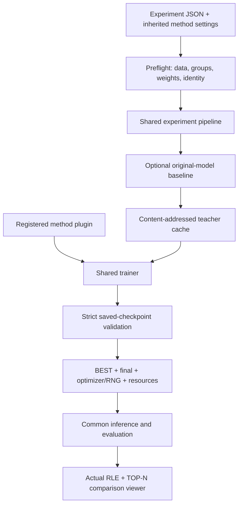

# Architecture / 架构

The experiment is data, configuration and recorded artifacts. The method is a
trainable scope, an objective and a validation preference. Keep them separate.

实验是数据、配置和产物；方法是训练范围、损失及选模偏好。两者分开，新增一个数据对照
不需要复制训练器，新增损失也不应重写上传、评测或网页代码。



## Boundaries / 模块边界

| Module | Owns | Does not own |
|---|---|---|
| `data.py` | JSONL, mask decoding, native dimensions, split overlap | Server paths or dataset copying |
| `methods/` | Trainable scope, objective, checkpoint comparison | GPU scheduling, plotting, experiment names |
| `training/` | Sampling, teacher cache, optimization, resume, validation | Private experiment IDs and source folders |
| `inference.py` | Fixed RGB/text inference and postprocessing | GT-based candidate selection |
| `metrics.py` | One-to-one completeness and TOP-N metrics | Training or threshold tuning on test data |
| `pipeline.py` | Ordered baseline/train/evaluate/review stages | A separate implementation for every model version |
| `report.py`, `assets/` | Display actual saved masks and metrics | Improving masks with GT |

## Configuration layers / 配置分层

- `configs/methods/`: reusable losses, teacher policy and optimization defaults.
- `configs/experiments/`: model/data paths, experiment name, output and overrides.
- `extends` merges dictionaries recursively. Runtime paths are relative to the
  **experiment file**; changing the shell working directory does not change them.
- A changed method, dataset or budget gets a new experiment/output directory.

## Artifacts are an interface / 产物也是接口

```text
run/
  identity.json                 content-based resume identity
  resolved_config.json          exact settings and local resolved paths
  data_audit.json               counts, groups and fingerprints
  trainable_parameters.json     actual parameter names/count
  train.jsonl                   optimization observations
  validation_*.json             checkpoint metrics and selection
  resources.json                training and validation resources
  checkpoints/step_*/           ordinary HF SAM3 checkpoints
  best -> checkpoints/step_*/   selected on validation
  final -> checkpoints/step_*/  last observed checkpoint
  resume.pt                     FP32 model, AdamW and RNG states
  evaluations/                  candidate RLE and metric exports
  reviews/                      static viewer per evaluation set
  pipeline.json                 workflow progress
```

The public workflow has no imports from the internal research workspace. Legacy
experiments and their full ledger are archived separately. This core supports
new experiments rather than embedding the historical experiment sequence.

See [verification and limits](verification.md) for the numerical checks and the
parts that still require a complete training run.
